# Running the tracker: a guide for operators

This guide takes you from an empty rented server to a working Corruption &
Fraud Tracker. It then covers the jobs you'll do afterwards: adding
people, taking and restoring backups, upgrading, and moving the tracker to
or from another operator.

You don't need to be a developer. Wherever you need to type something on
the server, the guide gives the exact text. Copy it, paste it into the
terminal and press Enter. Names of buttons, pages and fields are in bold,
spelled exactly as the tracker shows them, like **Save settings**.

> **Before you put real data in it,** read [DATA-ETHICS.md](../DATA-ETHICS.md).
> The tracker records allegations and convictions about real people. Some
> safeguards are built in and can't be switched off. Every item is
> reviewed by a person before it becomes a case. A hint of name
> suppression holds an item back until two different reviewers release it.
> Cases that haven't reached a verdict are marked ALLEGED. A new tracker
> shows nobody's name until an admin turns naming on
> ([section 6](#6-settings)). Other duties are
> yours as the operator: who you give access to, how carefully your
> reviewers check, and keeping cases up to date.

## Contents

1. [What you need](#1-what-you-need)
2. [Set up the server](#2-set-up-the-server)
3. [Open the tracker in your browser](#3-open-the-tracker-in-your-browser)
4. [The setup wizard](#4-the-setup-wizard)
5. [Add your team](#5-add-your-team)
6. [Settings](#6-settings)
7. [Ingestion: is everything running?](#7-ingestion-is-everything-running)
8. [Day-to-day work](#8-day-to-day-work)
9. [Backups](#9-backups)
10. [Restoring a backup](#10-restoring-a-backup)
11. [Upgrading](#11-upgrading)
12. [Stored passwords and keys after a move](#12-stored-passwords-and-keys-after-a-move)
13. [Receiving a tracker from another operator](#13-receiving-a-tracker-from-another-operator)
14. [Handing your tracker to another operator](#14-handing-your-tracker-to-another-operator)
15. [Starting again from empty](#15-starting-again-from-empty)
16. [When something goes wrong](#16-when-something-goes-wrong)

## 1. What you need

- **A server.** Rent a small virtual private server (a "VPS") from any
  hosting company. Pick Ubuntu 24.04 as the operating system, with at
  least 2 GB of memory and 20 GB of disk. The tracker has been tested with
  as little as 1 GB, but 2 GB leaves room for upgrades. The hosting company
  gives you the server's IP address (four numbers such as `203.0.113.10`)
  and a way to log in, usually as the user `root`.
- **A domain name (recommended).** Something like `tracker.example.org`.
  With a domain, the tracker gets a secure `https://` address
  automatically. Without one, you can still use it, but only through a
  connection from your own computer (see
  [section 3](#3-open-the-tracker-in-your-browser)).
- **An LLM API key.** The tracker uses a language model to read agency
  media releases and news articles and turn them into items for review.
  You need an API key from Anthropic, or from any service that offers an
  OpenAI-compatible API. Without a key, you can still review and add
  material by hand, but nothing is read automatically.
- **A mailbox for court alerts (optional).** This is an email account used
  only for court notification and alert subscriptions. The tracker reads
  it over IMAP.

On your own computer you need a terminal. On a Mac, open the *Terminal* app. On
Windows, open *PowerShell*. Both already include the `ssh` command used
below.

## 2. Set up the server

**Log in to the server.** In your terminal, type the following, with your
server's IP address instead of `203.0.113.10`:

```sh
ssh root@203.0.113.10
```

The first time, it asks whether you trust the server: type `yes`. Then
enter the password your hosting company gave you. Every command from here
until section 3 is typed into this server session.

**Install Docker and git.** Docker runs the tracker and its database. git
downloads the tracker's code. Paste these two lines:

```sh
curl -fsSL https://get.docker.com | sh
apt-get install -y git
```

This takes a minute or two.

**Download the tracker.**

```sh
git clone https://github.com/lonelycode/corruption-tracker.git
cd corruption-tracker
```

**Create the settings file.** The tracker needs one setting before it
starts: a password for its database. You never type this password
yourself. This line makes a random one and saves it in a file called
`.env`:

```sh
echo "POSTGRES_PASSWORD=$(openssl rand -hex 24)" > .env
```

**If you have a domain name,** point it at the server first. In your
domain provider's control panel, add an "A record" for the name (for
example `tracker`) with the server's IP address. Then add two lines to
`.env`, with your own domain instead of `tracker.example.org`:

```sh
echo "TRACKER_DOMAIN=tracker.example.org" >> .env
echo "COMPOSE_PROFILES=https" >> .env
```

If your hosting company has a firewall in its control panel, open ports 80
and 443 to the internet. The secure certificate is fetched through them.

**Start the tracker.**

```sh
docker compose up -d
```

The first start builds the tracker, which takes a few minutes. Later
starts take seconds. To check that it's running:

```sh
docker compose ps
```

You should see `db` and `tracker` (and `caddy`, if you set a domain), each
with a status of `Up` and `(healthy)`. If `tracker` says `(health:
starting)`, wait half a minute and run the command again.

Everything the tracker stores lives in two Docker volumes on this server,
called `db` and `data`. Stopping, restarting or upgrading the tracker
keeps them. One command deletes them, `docker compose down -v`, and this
guide only uses it in
[section 15](#15-starting-again-from-empty).

## 3. Open the tracker in your browser

**With a domain name:** go to `https://tracker.example.org`, using your own
domain.

**Without a domain name:** for safety, the tracker only accepts
connections from the server itself. To reach it, open a *new* terminal
window on your own computer and run this, with your server's IP address:

```sh
ssh -L 8080:127.0.0.1:8080 root@203.0.113.10
```

Leave that window open, and go to <http://localhost:8080> in your browser.
The connection lasts as long as that terminal window stays open.

## 4. The setup wizard

A new tracker opens on the setup wizard. You can do one of two things
here: create the first administrator and start with an empty tracker, or
start from an export bundle.

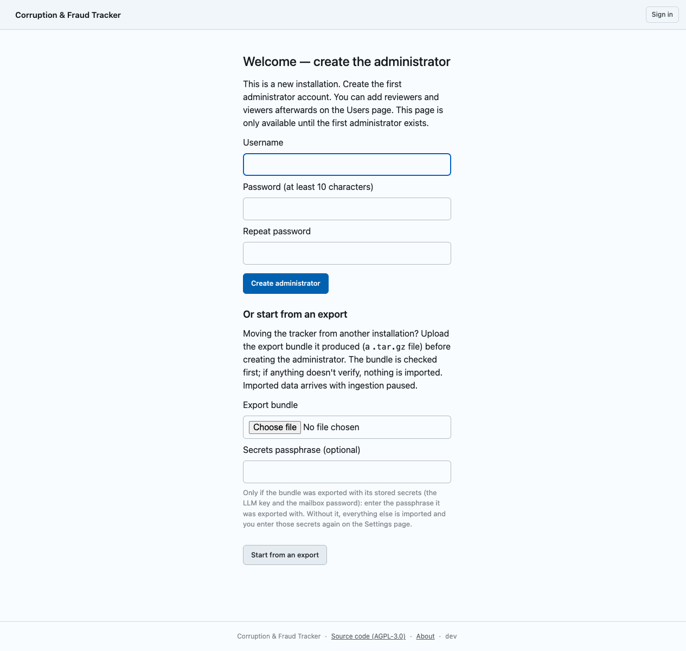

**To start empty,** fill in **Username**, **Password (at least 10
characters)** and **Repeat password**, then press **Create administrator**.
You are signed in and taken to the **Users** page.

**To start from an export:** an export bundle is a single `.tar.gz` file
that one tracker writes and another can read. Use one when you are taking
over a tracker from another operator (see
[section 13](#13-receiving-a-tracker-from-another-operator)), or to try
the tracker with sample data:

1. On your own computer, download the sample bundle
   [`sample-bundle.tar.gz`](sample/sample-bundle.tar.gz). It holds a few
   invented cases about invented people (Vera Verified, Alan Alleged,
   Petra Pending), so you can see how everything looks without real data.
2. Under **Or start from an export**, press the file button next to
   **Export bundle** and pick the file.
3. Leave **Secrets passphrase (optional)** empty, unless whoever sent you
   the bundle also gave you a passphrase for its stored secrets
   ([section 12](#12-stored-passwords-and-keys-after-a-move)).
4. Press **Start from an export**. The tracker checks every part of the
   bundle before importing anything. If any part fails the check,
   including a wrong passphrase, nothing is imported, and the page tells
   you why.
5. A green message confirms the import, and says whether stored secrets
   came with it. Now create the administrator as above.

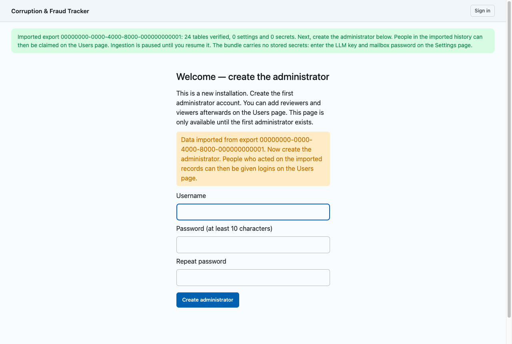

An imported tracker starts with ingestion paused: it doesn't fetch
anything new until you say so. This gives you time to check the data and
enter your settings first. When you're ready, press **Resume ingestion**
on the **Handoff** or **Ingestion** page
([section 13](#13-receiving-a-tracker-from-another-operator), step 4).

An imported tracker also starts with naming off, whatever the old
tracker did: case pages and reports show no names until you turn naming
on ([section 6](#6-settings)).

If you only imported the sample to look around, you can wipe the tracker
afterwards and start again ([section 15](#15-starting-again-from-empty)).

## 5. Add your team

Go to **Users**. Each person gets their own account. Users are never
deleted, only disabled, so the history of who did what stays intact.

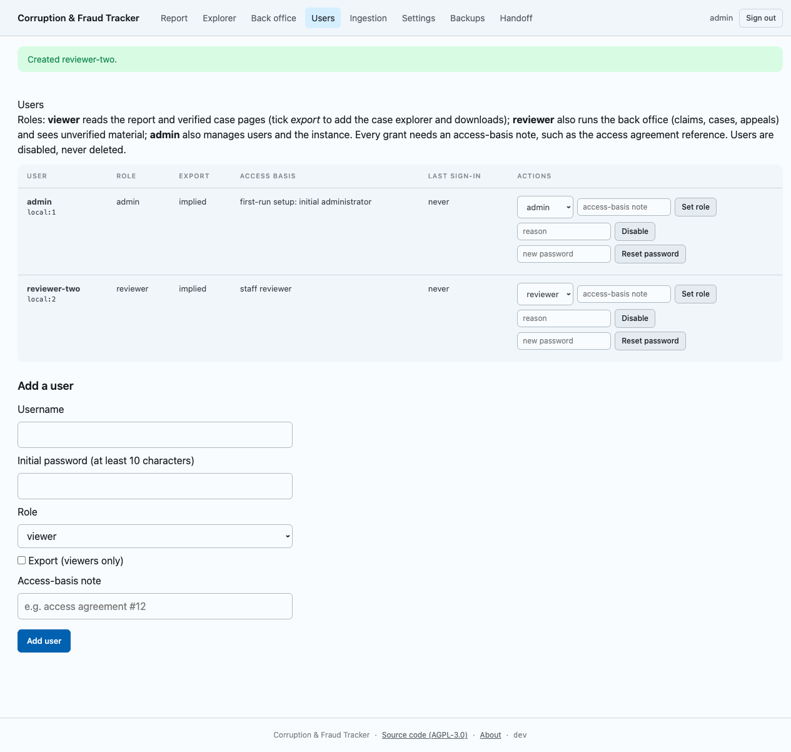

There are three roles:

- **viewer** reads the report and the verified case pages. Tick
  **Export (viewers only)** to also let them use the case explorer and
  download data. Only do this for people whose access agreement allows it.
- **reviewer** also works in the **Back office**: they review incoming
  items, edit cases and record appeals. Reviewers see unverified material.
- **admin** can do everything a reviewer can, and also manages users and
  the tracker itself.

To add someone, fill in **Username**, **Initial password (at least 10
characters)**, **Role** and **Access-basis note**, then press **Add
user**. The access-basis note records why this person has access, for
example "access agreement #12". Every account needs one. Give the person
their password in a safe way. They can't change it themselves yet, so
if they need a new one, an admin sets it with **Reset password**.

**Add at least two reviewers (or admins).** Items that mention name
suppression are held in quarantine. Two *different* reviewers must agree
before one can be released.

**If you imported a tracker from another operator,** the people who
reviewed cases there appear under **Claim an imported reviewer**. Claiming
one creates a login for that person, linked to their existing review
history. That way, the record of who verified each case stays continuous.
(The sample bundle has no such people, so this section doesn't appear
after a sample import.)

## 6. Settings

Go to **Settings**. Changes take effect as soon as you press **Save
settings**. Two fields say *Takes effect after a restart*: **Source code
URL** and **Time zone**. After changing either, restart the tracker on
the server:

```sh
cd ~/corruption-tracker
docker compose restart tracker
```

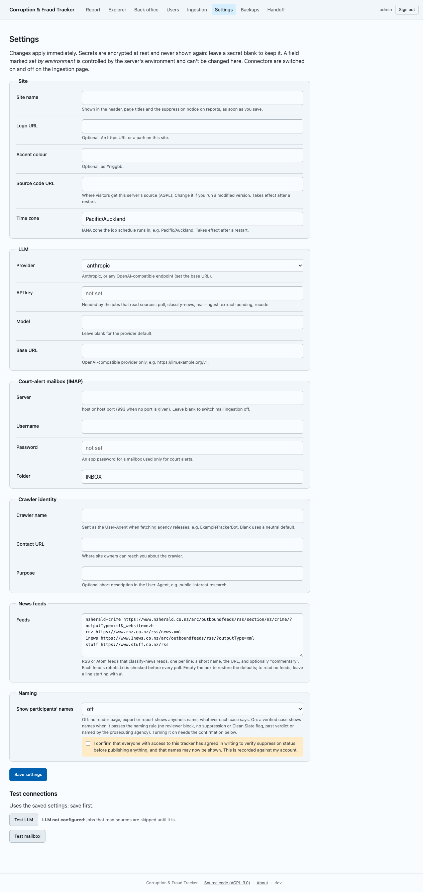

**Site**

- **Site name**: your organisation's or project's name for the tracker. It
  appears in the header and page titles, and in the notice on case pages
  and reports that names you as the operator responsible for the data.
- **Logo URL** and **Accent colour**: optional branding.
- **Source code URL**: leave this alone unless you've changed the code.
  The licence (AGPL) requires that people who use the tracker can get its
  source.
- **Time zone**: the time zone the job schedule runs in. The default is
  `Pacific/Auckland`.

**LLM**

- **Provider**: `anthropic`, or `openai-compatible` for other services.
- **API key**: paste your key. It is stored encrypted and never shown
  again. To keep the stored key, leave the field blank when saving other
  changes. To remove it, tick **clear**.
- **Model**: leave blank to use the provider's default.
- **Base URL**: only for `openai-compatible`. The service tells you what
  to put here.

**Court-alert mailbox (IMAP)**

- **Server**, **Username**, **Password**, **Folder**: the details of the
  alert mailbox. Your email provider tells you the IMAP server name. Many
  providers want an "app password" here rather than the account's normal
  password. Leave **Server** blank if you don't use a mailbox.

**Crawler identity**

When the tracker fetches agency media releases, it introduces itself to
those websites.

- **Crawler name**: a short name for that introduction, such as
  `ExampleTrackerBot`.
- **Contact URL**: a page where website owners can reach you.
- **Purpose**: optional; a few words such as "public-interest research".

**News feeds**

- **Feeds**: the news sites the tracker reads, one per line. The defaults
  are filled in for you. Empty the box to go back to the defaults.

**Naming**

- **Show participants' names**: `off` until you change it. While it's
  off, no case page, explorer view, download or report shows anyone's
  name, or the case summaries that carry names, and the explorer's search
  ignores names. Reviewers still see names in the **Back office**, where
  they need them to check sources.

  Turn it on only when everyone with access to the tracker has agreed in
  writing to check suppression status before publishing anything. To turn
  it on, choose `on`, tick the confirmation box underneath, and press
  **Save settings**. Without the tick, nothing is saved. The tracker
  records who turned naming on and when.

  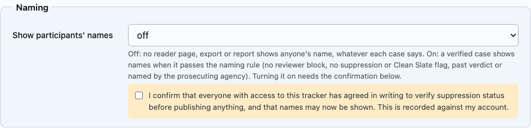

  Once naming is on, a verified case shows names only when it passes the
  naming rule in [DATA-ETHICS.md](../DATA-ETHICS.md). A reviewer can
  still block names on any single case. Setting it back to `off` hides
  every name again at once.

**Check your settings work.** After saving, press **Test LLM** and **Test
mailbox** under **Test connections**. Each one tells you whether the
connection worked, and if not, why. Until an LLM key is saved, the page
shows **LLM not configured**, and the jobs that read sources skip their
runs.

A field marked *set by environment* has been fixed by whoever set up the
server, and can't be changed on this page. With the standard setup in
this guide, no field is.

## 7. Ingestion: is everything running?

Go to **Ingestion**. This page shows whether the tracker is fetching new
material, and how each scheduled job last went.

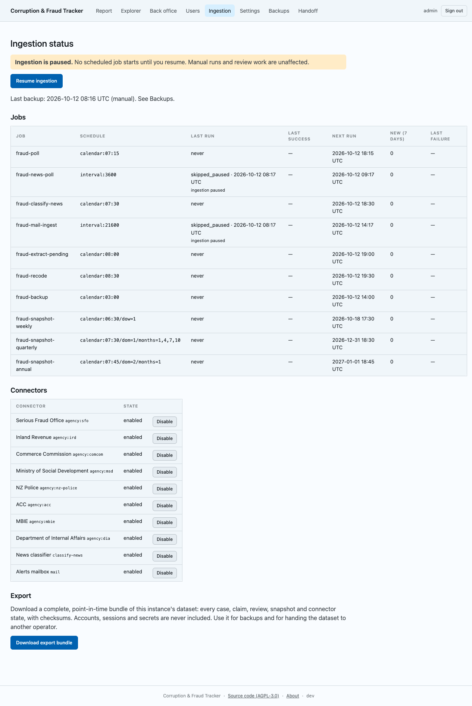

- **Pause ingestion** / **Resume ingestion**: pausing stops every
  scheduled job from starting. Review work carries on as normal. An
  imported tracker starts paused. The first time you resume it, here or
  on **Handoff**, each source also catches up on what it published while
  the tracker was moving
  ([section 13](#13-receiving-a-tracker-from-another-operator)).
- **Jobs**: one row per scheduled job, showing its last run, its last
  success, its next run, how many new items it found in the last 7 days,
  and its last failure, with the error. A job that keeps failing usually
  points at a setting: the LLM key, the mailbox, or a feed.
- **Connectors**: each source the tracker reads (one per agency, the news
  classifier and the alert mailbox). Press **Disable** to stop reading
  that source, and **Enable** to start again.
- **Download export bundle**: downloads everything in the tracker as one
  file: every case, item, review and report. User accounts, sessions and
  stored keys are never included. Use it to keep an extra copy, or to hand
  the tracker over ([section 14](#14-handing-your-tracker-to-another-operator)).

## 8. Day-to-day work

Everything the tracker finds lands in the **Back office** as an
*unverified claim*. Nothing reaches the case register or the reports until
a reviewer approves it.

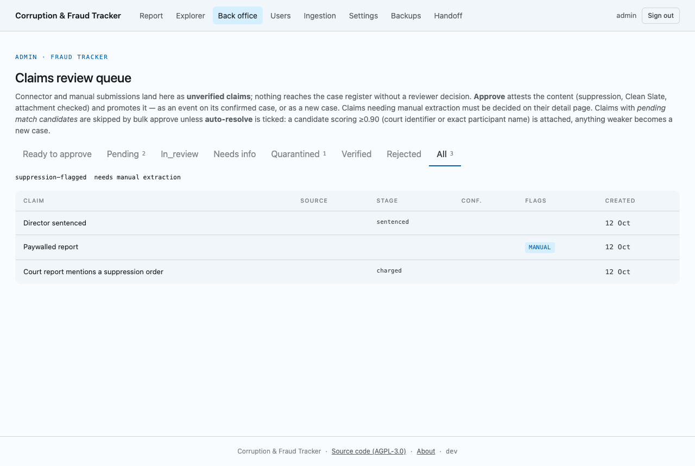

The tabs sort claims by state. **Quarantined** holds anything with a hint
of name suppression; releasing one needs two different reviewers. Open a
claim to read the source and decide on it.

Approved cases get their own page, with participants, a court timeline and
sources. While naming is off (the default), participants appear as
"Participant 1", "Participant 2" and so on:

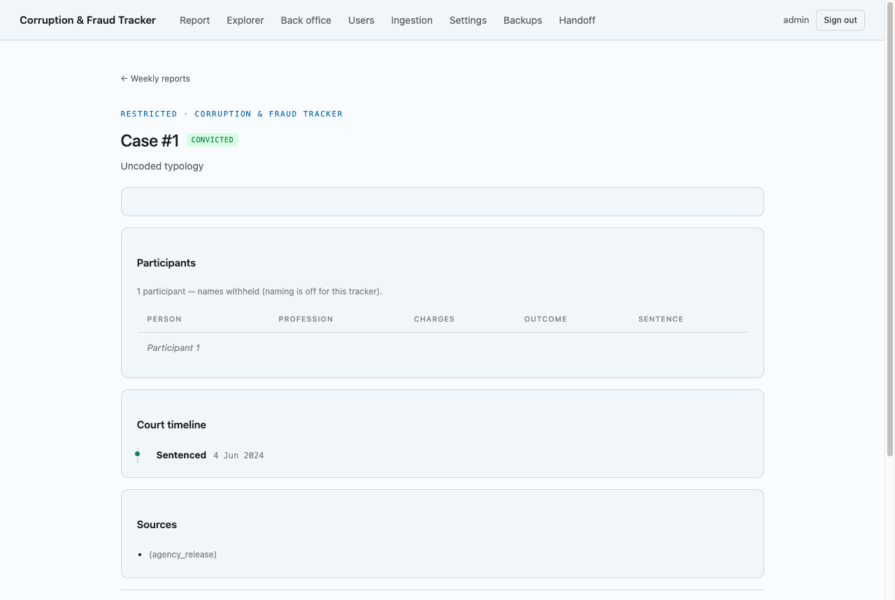

The **Report** is the weekly, quarterly and annual summary. Reports are
versioned: a correction issues a new, visibly revised version rather than
quietly changing an old one.

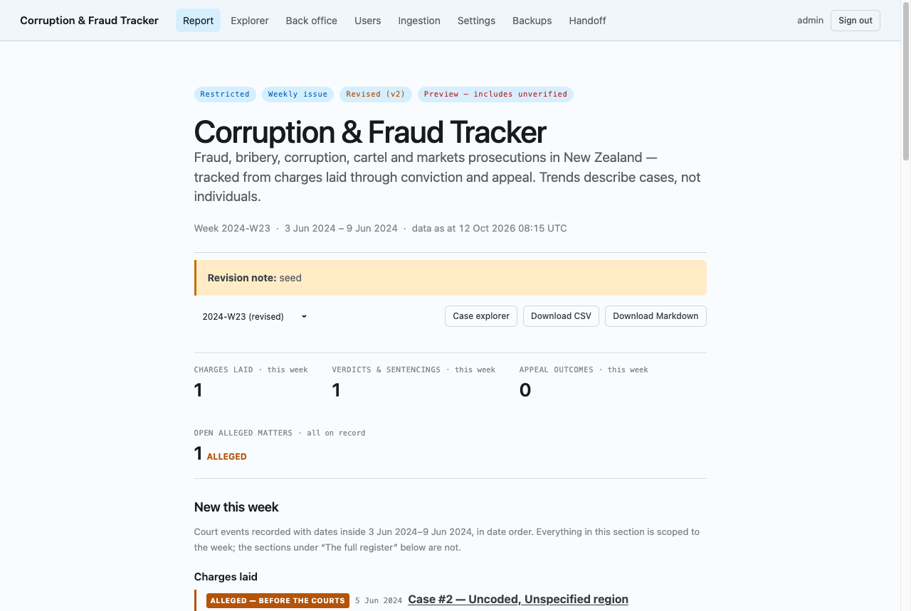

## 9. Backups

The tracker backs itself up every night at 03:00 (in the **Time zone**
from Settings), and again before any upgrade that changes its database.
Go to **Backups** to see them, take one by hand with **Back up now**, or
download one.

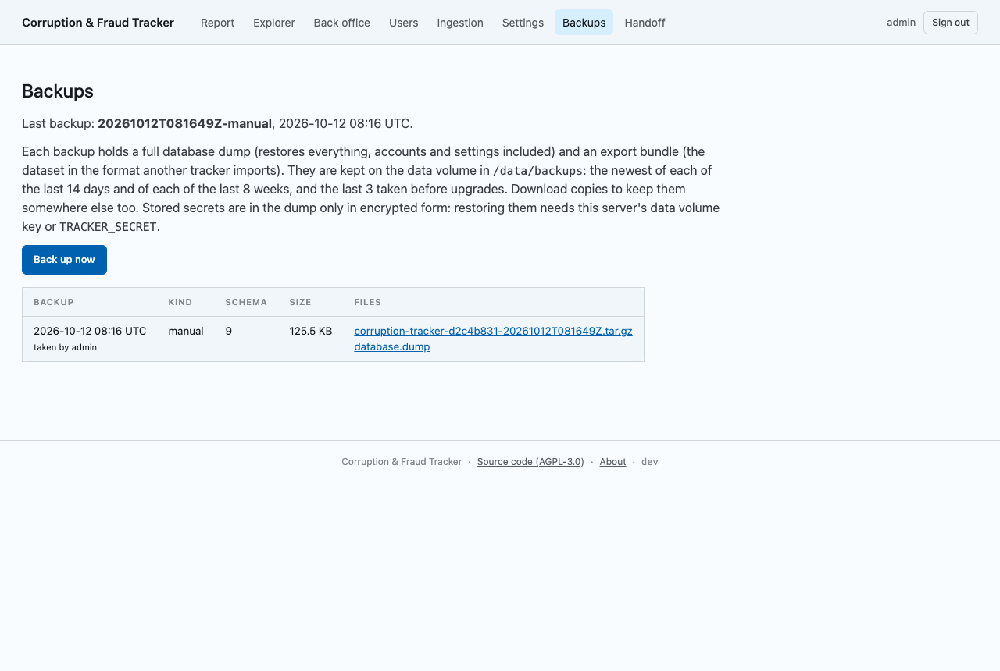

Each backup has two files:

- `database.dump` restores the whole tracker as it was, accounts and
  settings included.
- The `.tar.gz` file is an export bundle that another tracker can import.

Backups are kept on the server: the newest of each of the last 14 days,
the newest of each of the last 8 weeks, and the last 3 taken before
upgrades. **A backup that only exists on the server is lost if the server
is lost.** Download a copy regularly and keep it somewhere else, under the
same care as the data itself.

**Also keep a copy of the server's secret key.** The LLM key and the
mailbox password are stored encrypted, and the key that unlocks them lives
in a file called `secret.key` on the server, not in the backups. The file
appears the first time you save one of those settings. To copy it, run
these two commands on the server:

```sh
cd ~/corruption-tracker
docker compose cp tracker:/data/secret.key ./secret.key
```

Then download it to your own computer. In a terminal on *your computer*,
with your server's IP address, run:

```sh
scp root@203.0.113.10:corruption-tracker/secret.key .
```

Keep that file as safely as a password, and delete it from the server
afterwards (`rm ~/corruption-tracker/secret.key`). **Keep it apart from
your downloaded backups.** Anyone who has both a backup and this file
can read the stored LLM key and mailbox password. Without it, a restored
tracker still has all its cases and users, but you need to type the LLM
key and mailbox password in again ([section 12](#12-stored-passwords-and-keys-after-a-move)).

If the newest backup is more than 36 hours old, the **Backups** and
**Ingestion** pages show a warning. Check the `fraud-backup` job on the
**Ingestion** page for the error.

## 10. Restoring a backup

Use this to rebuild the tracker on a new server, or to undo a disaster on
the current one. You need a `database.dump` file that you downloaded from
the **Backups** page, and ideally your `secret.key`.

1. Set up the server as in [section 2](#2-set-up-the-server), up to and
   including creating `.env`, but *don't* run `docker compose up -d`
   yet. If you're restoring over a tracker that already exists, wipe it
   first ([section 15](#15-starting-again-from-empty)); restore refuses to
   overwrite one that has accounts or cases.
2. Copy the files to the server. In a terminal on *your computer*, in the
   folder where the files are:

   ```sh
   scp database.dump secret.key root@203.0.113.10:corruption-tracker/
   ```

3. Back on the server, run these commands one at a time:

   ```sh
   cd ~/corruption-tracker
   sudo chown 10001 database.dump
   docker compose up -d db
   docker compose run --rm -v "$PWD/database.dump:/restore/database.dump:ro" tracker restore /restore/database.dump
   ```

   The first line lets the tracker read the file, without letting
   anyone else on the server read it. The last line says
   `restored … (schema now …)` when it's done. The dump holds the whole
   database, password hashes included, so delete it from the server
   once the restore has worked:

   ```sh
   rm database.dump
   ```

4. If you have `secret.key`, put it in place:

   ```sh
   docker compose run --rm --no-deps --user root -v "$PWD/secret.key:/restore/secret.key:ro" --entrypoint sh tracker -c 'install -o tracker -g tracker -m 600 /restore/secret.key /data/secret.key'
   rm secret.key
   ```

5. Start everything:

   ```sh
   docker compose up -d
   ```

Sign in with the same usernames and passwords as before. A backup from an
older version of the tracker is upgraded automatically as it's restored.

## 11. Upgrading

On the server:

```sh
cd ~/corruption-tracker
git pull
docker compose up -d --build
```

The tracker takes a backup before any upgrade that changes its database,
so there is always a way back. Upgrades don't touch your data, users or
settings.

*Once ready-made releases are published,* the commands become
`docker compose pull` followed by `docker compose up -d`. The project's
README will say when.

## 12. Stored passwords and keys after a move

The **API key** (LLM) and the mailbox **Password** are stored encrypted.
They can only be read on a server that has the same `secret.key` file as
the one that saved them.

*An alternative to copying the file:* put the same `TRACKER_SECRET` line
in `.env` on every server that should share the stored secrets. Then
there is no key file to copy. Make one with:

```sh
echo "TRACKER_SECRET=$(openssl rand -hex 32)" >> .env
```

Set it before the first secret is saved (best: before the first start),
or never, and keep it for good. It is a different key from `secret.key`,
so switching later doesn't lose any data, but the LLM key and mailbox
password must be entered again on **Settings**. Keep the line as safely as
`secret.key` itself, and apart from your backups.

So they don't come with you automatically when:

- you restore a backup on a new server without copying `secret.key`
  across ([section 10](#10-restoring-a-backup)), or
- you take over a tracker from another operator, and the bundle doesn't
  carry them. The **Download export bundle** button on **Ingestion**
  never includes them. A bundle made on the server with
  `export --include-secrets` does, encrypted under a passphrase that the
  sender chooses (in `TRACKER_EXPORT_PASSPHRASE`). Enter that passphrase
  under **Secrets passphrase (optional)** in the setup wizard, and they
  are restored with everything else. The import message says whether
  they were.

In both cases, everything else arrives intact: cases, reviews, reports
and, after a restore, user accounts. Go to **Settings**. A stored secret
that can't be read says **stored but unreadable: re-enter**. Type the LLM
key and the mailbox password again, press **Save settings**, then **Test
LLM** and **Test mailbox**.

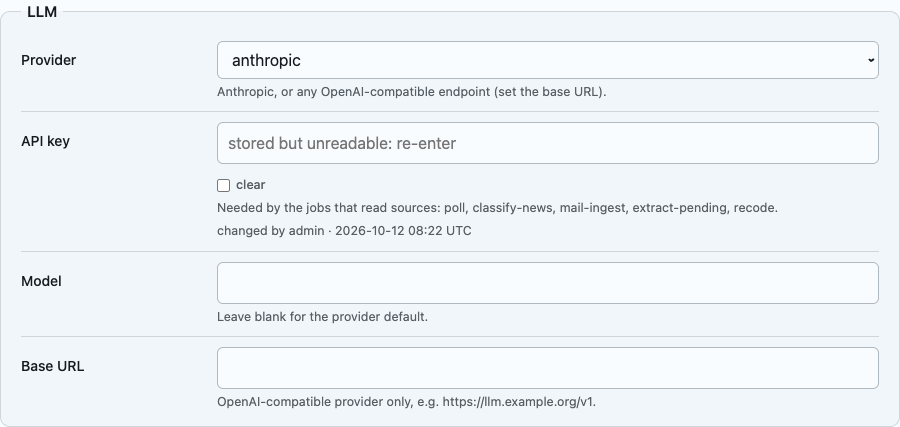

## 13. Receiving a tracker from another operator

Sometimes a tracker moves from one organisation to another. The sending
operator freezes their tracker, so nothing changes while it moves, and
sends you its *handoff bundle* (an export bundle taken while frozen).
Agree a secure way to send that file: it holds everything, including
unverified material.

1. Set up your server ([section 2](#2-set-up-the-server)) and open the
   setup wizard.
2. Use **Start from an export** with the bundle you were sent, then create
   your administrator ([section 4](#4-the-setup-wizard)). If the sender
   gave you a passphrase for the bundle's stored secrets, enter it under
   **Secrets passphrase (optional)**. Agree a different way of sending it
   from the one used for the bundle.
3. Go to **Handoff**. It confirms where the data came from and shows the
   **Handoff checklist**:

   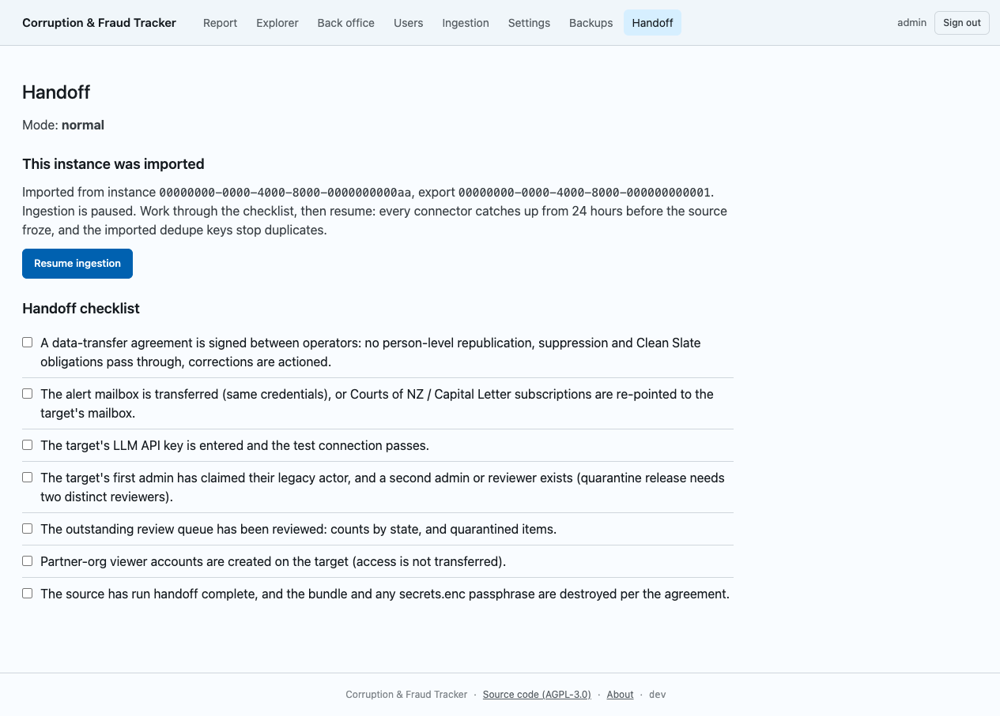

   Work through each item. In practice:

   - The data-transfer agreement with the sending operator is signed.
   - The alert mailbox works on your side: enter it in **Settings** and
     press **Test mailbox**, or move the court alert subscriptions to your
     own mailbox.
   - Your LLM **API key** is entered and **Test LLM** passes
     ([section 12](#12-stored-passwords-and-keys-after-a-move)).
   - Under **Users**, claim the imported reviewers you're keeping, and
     make sure at least two reviewers or admins exist
     ([section 5](#5-add-your-team)).
   - Someone has looked through the **Back office** queue, including
     anything quarantined.
   - Accounts for partner organisations are created again on your
     tracker. Logins don't transfer.
   - Naming is off on your tracker after the import, even if it was on
     before. Each case keeps its own reviewer decision about naming.
     Turn naming on under **Settings** only once your own access
     agreements are in place ([section 6](#6-settings)).
   - The sending operator has completed the handoff on their side.

   The tick boxes are there to help you keep track. The tracker doesn't
   remember them.

4. Press **Resume ingestion**, here or on **Ingestion**. Each source
   catches up from 24 hours before the other tracker froze. Nothing is duplicated, because the tracker
   knows which items it already has.

## 14. Handing your tracker to another operator

Do this only under a written data-transfer agreement (see
[DATA-ETHICS.md](../DATA-ETHICS.md)). Agree a time with the receiving
operator, and let them set up their server first.

1. Go to **Handoff** and press **Freeze for handoff**. Your tracker
   becomes read-only: nobody can change cases or reviews, and scheduled
   jobs stop. Every page shows a banner saying so. Signing in,
   **Settings** and downloading the export still work. New user accounts
   can't be created while frozen: create them on the new tracker
   instead.

   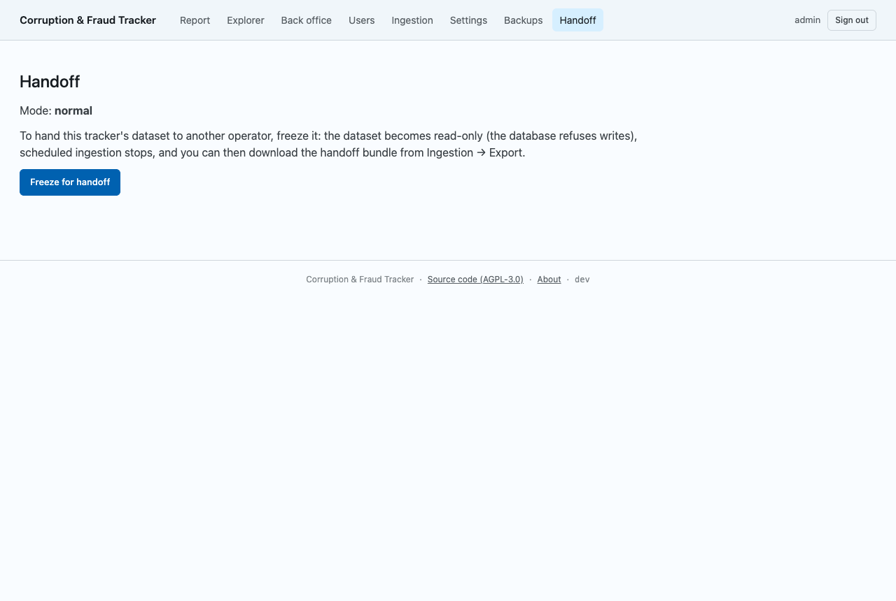

2. When the **Handoff** page says **No jobs are running**, go to
   **Ingestion** and press **Download export bundle**. Taken while frozen,
   this is the handoff bundle.
3. Send the file to the receiving operator in the agreed, secure way. They
   follow [section 13](#13-receiving-a-tracker-from-another-operator).
   Stored keys and passwords are not in a bundle downloaded from
   **Ingestion**. If your agreement says to hand them over, the receiver
   can enter them on their **Settings** page. Alternatively, whoever runs
   your server can make the bundle with `export --handoff --include-secrets`,
   which encrypts them under a passphrase you then send separately.
4. Back on **Handoff**, the **Handoff export id** is filled in for you.
   Enter the new tracker's address under **Successor URL**. It must be an
   `https://` address. Then press **Complete handoff**. Your tracker stays read-only for good, and its
   banner points visitors to the new address.

   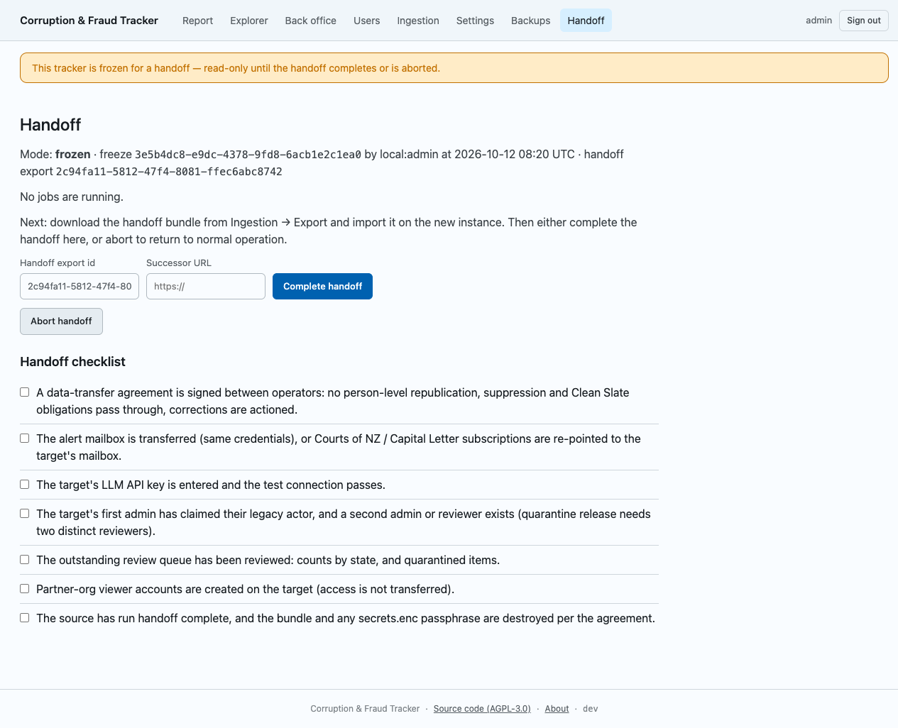

Changed your mind before completing? Press **Abort handoff** and your
tracker goes back to normal. Delete any bundle you downloaded during the
aborted freeze: it is out of date.

## 15. Starting again from empty

This *permanently deletes* every case, user, setting and backup on this
server. Download anything you want to keep first.

```sh
cd ~/corruption-tracker
docker compose down -v
docker compose up -d
```

The tracker opens on the setup wizard again.

## 16. When something goes wrong

Run these on the server, from inside the `corruption-tracker` folder
(`cd ~/corruption-tracker` first).

**Is it running?**

```sh
docker compose ps
```

Each service should be `Up` and `(healthy)`. If one isn't, start
everything again with `docker compose up -d`.

**What is it saying?** This shows the tracker's most recent log lines:

```sh
docker compose logs --tail 100 tracker
```

When you ask someone for help, include these lines, after checking
they contain nothing you'd rather not share.

**The browser can't connect.**
- Without a domain: is the `ssh -L …` window from
  [section 3](#3-open-the-tracker-in-your-browser) still open?
- With a domain: does the domain point at the server's IP address, and
  are ports 80 and 443 open in your hosting company's firewall? Look at
  `docker compose logs caddy` for certificate errors. A new domain can
  take up to an hour to work everywhere.

**Someone forgot their password.** An admin can set a new one on the
**Users** page with **Reset password**. If no admin can sign in, run this
on the server, with the username instead of `NAME`:

```sh
docker compose exec tracker corruption-tracker user reset-password NAME
```

It prints a new random password once, and signs that user out everywhere.
To see every username:

```sh
docker compose exec tracker corruption-tracker user list
```

**Case pages and reports show no names.** Naming is off, which is the
default, including after an import. See **Naming** in
[section 6](#6-settings) before you turn it on.

**Nothing new is arriving.**
- On **Ingestion**, is it paused? Press **Resume ingestion**.
- Does **Settings** show **LLM not configured**? Enter the API key.
- Look at the **Last failure** column in the **Jobs** table for the error.
- Is the source switched off under **Connectors**?

**Settings shows "stored but unreadable: re-enter".** The server doesn't
have the key that saved that secret. Type it in again
([section 12](#12-stored-passwords-and-keys-after-a-move)).

**Every page has a "frozen for a handoff" banner, and saving gives an
error page.** A handoff has started on this tracker. Go to **Handoff** to
complete it, or press **Abort handoff** to go back to normal
([section 14](#14-handing-your-tracker-to-another-operator)).

**A warning says the newest backup is old.** The nightly backup isn't
working. Check the `fraud-backup` row on **Ingestion** for its error, and
press **Back up now** on **Backups** to see whether a backup works by
hand. A full disk is the most common cause; your hosting company's control
panel shows the disk use.

**Restore says the tracker isn't empty.** Restore won't overwrite a
tracker that already has accounts or cases. Wipe it first
([section 15](#15-starting-again-from-empty)), then restore.

**The import in the setup wizard fails.** Nothing has been imported; the
message says which part didn't check out. Ask the sender for a fresh copy
of the bundle: the file was probably damaged or cut short in transit.
